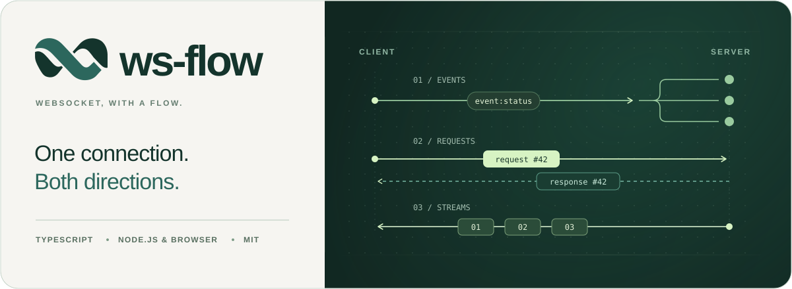
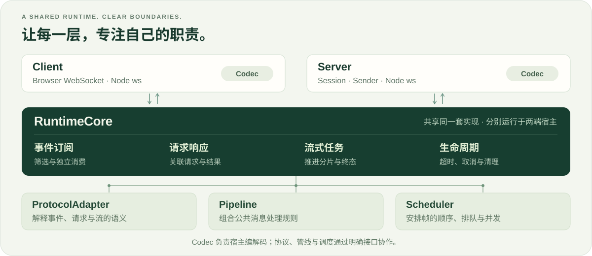

<p align="center">
  <picture>
    <source media="(max-width: 640px)" srcset="docs/media/readme/banner-mobile.svg">
    
  </picture>
</p>

<p align="center">
  <strong>一套模块化、可扩展的 WebSocket 双向通信架构。</strong><br>
  订阅关心的事件，等待对应的答案，让连续结果自然流动。
</p>

<p align="center">
  <a href="#get-started">快速开始</a> ·
  <a href="https://mr-pardon.github.io/ws-flow/guide/">用户手册</a> ·
  <a href="docs/manual/examples/index.md">完整案例</a> ·
  <a href="#architecture">架构与扩展</a> ·
  <a href="CONTRIBUTING.md">参与开发</a>
</p>

<br>

## 认识 ws-flow

**让每条消息有所归属，让每次调用都有清晰的生命周期。**

ws-flow 将事件订阅、请求响应和流式任务组织成一套连贯的 API。它负责消息分流、结果关联、超时与取消，让业务代码直接表达通信意图。Client 可以独立连接已有服务，也可以与 Server 配套构建完整的双向通信。

<table>
  <tr>
    <td width="50%">
      <strong>01 · 只订阅你关心的</strong><br><br>
      从持续到达的消息里筛选事件。每个订阅独立消费，让状态、日志与业务通知各行其道。<br><br>
      <code>subscribe</code> / <code>on</code>
    </td>
    <td width="50%">
      <strong>02 · 发起请求，直接拿到答案</strong><br><br>
      用 <code>await</code> 等待对应结果。Client 和 Server 都能发起调用，内核负责关联与回收。<br><br>
      <code>request</code> / <code>handleRequest</code>
    </td>
  </tr>
  <tr>
    <td>
      <strong>03 · 让一次任务持续返回</strong><br><br>
      用 <code>for await</code> 读取进度与分片。一次请求对应一条结果流，结束与取消各有归属。<br><br>
      <code>requestStream</code> / <code>handleStream</code>
    </td>
    <td>
      <strong>04 · 主动推送连续数据</strong><br><br>
      将采样、日志批次或连续更新组织为独立数据流，从开始到结束统一管理。<br><br>
      <code>stream</code> / <code>onStream</code>
    </td>
  </tr>
</table>

协议适配、插件管线与调度策略提供清晰的扩展入口。先从默认配置开始，需要接入新的消息约定或处理规则时，再组合相应模块。

<br>

<a name="get-started"></a>

## 开始一次通信

**注册一个处理函数，连接，然后等待结果。**

在 Node.js 22+ 的 ESM 项目中安装：

```sh
npm install @ws-flow/client@^2 @ws-flow/server@^1 ws@8
```

**服务端 · `server.ts`**

```ts
import { WSServer } from '@ws-flow/server'

const server = WSServer.create({ port: 8080 })

server.handleRequest<number, number>('double', ctx => ctx.data * 2)
```

**客户端 · `client.ts`**

```ts
import { WSClient } from '@ws-flow/client/node'

const client = new WSClient({ protocol: 'ws-flow' })
await client.connect('ws://localhost:8080')

const result = await client.request<number>('double', 21)
console.log(result) // 42
```

先启动服务端，再运行客户端，即可得到 `42`。处理函数也可以是 `async`；Server 通过 `session.request()` 可以反向调用 Client。文件运行步骤见[快速开始](docs/manual/guide/quick-start.md)。

连接可以持续复用。应用退出时，客户端调用 `client.dispose()`，服务端调用 `server.close()`。

<details>
<summary><strong>再走一步：让同一次请求连续返回进度</strong></summary>

在上面的 `server.ts` 中增加一个流式处理器，用 `yield` 交付每一步结果：

```ts
server.handleStream('progress', async function* () {
  yield 20
  yield 60
  yield 100
})
```

在已连接的 `client.ts` 中，用异步迭代逐个读取：

```ts
for await (const progress of client.requestStream<number>('progress', null)) {
  console.log(`进度：${progress}%`)
}
```

`null` 表示这个任务无需输入。生成器结束，循环随之结束；提前 `break` 会结束本地消费，并尽力通知远端取消。真实业务通过 `ctx.signal` 配合停止工作。

[流式任务指南](docs/manual/guide/streams.md) · [可取消的进度任务](docs/manual/examples/cancellable-task.md)

</details>

<br>

## 已有服务，也能独立接入

**保留你的消息格式，让 Client 接入现有的通信约定。**

浏览器项目只需安装 `@ws-flow/client@^2`。Client 默认使用 `generic` 模式，无需对端采用 ws-flow 的 Envelope。下面假设已有服务接受订阅命令，并持续返回 JSON 消息：

```ts
import { WSClient } from '@ws-flow/client/browser'

const client = new WSClient()
const messages = client.subscribe(() => true)

await client.connect('wss://your-service.example/socket')
await client.send({ action: 'subscribe', topic: 'prices' })

for await (const message of messages) {
  console.log(message.raw)
}
```

替换为实际服务地址与命令即可。订阅先于发送建立，及时接住返回的消息；将筛选函数替换为你的条件，就能把关心的数据单独分流。

浏览器使用原生 WebSocket，Node.js 使用 `ws`。默认 Codec 处理 JSON；纯文本、二进制与命名事件可以按服务约定配置。请求、流和远端取消需要对端协议支持，再由适配器衔接相应能力。

<sub>循环中的 `break` 或 `messages.cancel()` 结束本地订阅；不再使用客户端时调用 `client.dispose()`。</sub>

[独立 Client 案例](docs/manual/examples/generic-client.md) · [事件与订阅](docs/manual/guide/events.md) · [协议适配](docs/manual/guide/extensions.md)

<br>

<a name="architecture"></a>

## 清晰的分层，留给业务生长的空间

**连接接入、任务模型与扩展规则各有职责，两端沿用同一套通信语义。**

<picture>
  <source media="(max-width: 640px)" srcset="docs/media/readme/architecture-mobile.svg">
  
</picture>

Client 管理连接与重连，Server 通过 Session、房间和 Sender 组织客户端。两端各自运行 RuntimeCore，由同一套实现维护请求关联、流状态与任务清理。

| 当业务需要变化 | 扩展的位置 | 承担的职责 |
| :--- | :--- | :--- |
| 收发纯文本或特定二进制格式 | **Codec** | 在传输表示与业务对象之间编解码 |
| Client 接入既有服务的消息约定 | **ProtocolAdapter** | 解释事件、请求与流的语义 |
| 统一日志、校验或数据转换 | **插件与中间件** | 将公共规则组合到消息处理阶段 |
| 调整帧的排队、顺序与并发 | **Scheduler** | 安排消息帧的执行策略 |

例如，为服务端的入站消息统一记录日志，只需注册一个插件：

```ts
import { WSServer } from '@ws-flow/server'

const server = WSServer.create({ port: 8080 })

server.use({
  receive: async (ctx, next) => {
    console.log('收到消息：', ctx.session.id, ctx.envelope.event)
    await next()
  }
})
```

插件可以抽成独立模块复用。业务处理器继续专注输入与结果，内核继续管理任务生命周期。

[架构模型](docs/manual/design/index.md) · [扩展指南](docs/manual/guide/extensions.md) · [Server 与连接组织](docs/manual/guide/server.md)

<details>
<summary><strong>了解交付、取消与重连的边界</strong></summary>

- `send` / `emit` 完成表示本地发送阶段结束；需要确认对端业务结果时使用 `request`。
- 取消通过 `AbortSignal` 协作完成。内核清理本地任务，业务负责停止实际工作；重连恢复连接，普通订阅需要重新建立，请求和流不会自动重放。
- 队列、传输字节、活动任务与期限可分别配置。这些保护管理特定资源，不构成端到端背压或持久化交付。

[连接与生命周期](docs/manual/guide/lifecycle.md) · [资源与期限](docs/manual/reference/resources.md) · [错误处理](docs/manual/reference/errors.md)

</details>

<br>

## 从这里继续

| 你想做什么 | 从这里进入 |
| :--- | :--- |
| 跑通第一组 Client / Server | [快速开始](docs/manual/guide/quick-start.md) |
| 接入已有服务，筛选关心的数据 | [通用客户端案例](docs/manual/examples/generic-client.md) |
| 在长任务中读取进度、响应取消 | [可取消任务案例](docs/manual/examples/cancellable-task.md) |
| 从 Server 查询一组客户端的状态 | [双向调用与结果收集](docs/manual/examples/duplex.md) |
| 查阅接口、配置与错误 | [API 参考](docs/manual/reference/index.md) |

<details>
<summary><strong>维护与模块导航</strong></summary>

业务应用按需安装 Client 或 Server，基础模块由依赖自动安装。各包提供独立的职责说明与维护入口。

| 模块 | 职责 |
| :--- | :--- |
| [Client](packages/client/README.md) | 浏览器与 Node.js 连接宿主 |
| [Server](packages/server/README.md) | 会话、房间与多目标通信 |
| [RuntimeCore](packages/runtime-core/README.md) | 订阅、请求、流与生命周期 |
| [Envelope](packages/envelope/README.md) | 配套协议的消息结构与构造 |
| [Pipeline](packages/pipeline/README.md) | 插件与中间件组合 |
| [Scheduler](packages/scheduler/README.md) | 消息帧的排队与执行 |
| [Consumer](packages/consumer/README.md) | 队列与异步消费 |

本地开发、验证与代码规范见[贡献指南](CONTRIBUTING.md)。Client 1.x 用户可阅读[升级说明](docs/manual/reference/migration.md)。

</details>

<br>

## 作者与许可

ws-flow 由 **Mr_Pardon** 发起与设计，采用 [MIT License](LICENSE) 开源。

欢迎[反馈问题](https://github.com/Mr-Pardon/ws-flow/issues)、分享使用场景或[参与贡献](CONTRIBUTING.md)。版本变化见[更新日志](CHANGELOG.md)。

<p align="center"><sub>让双向通信，有条不紊。</sub></p>
