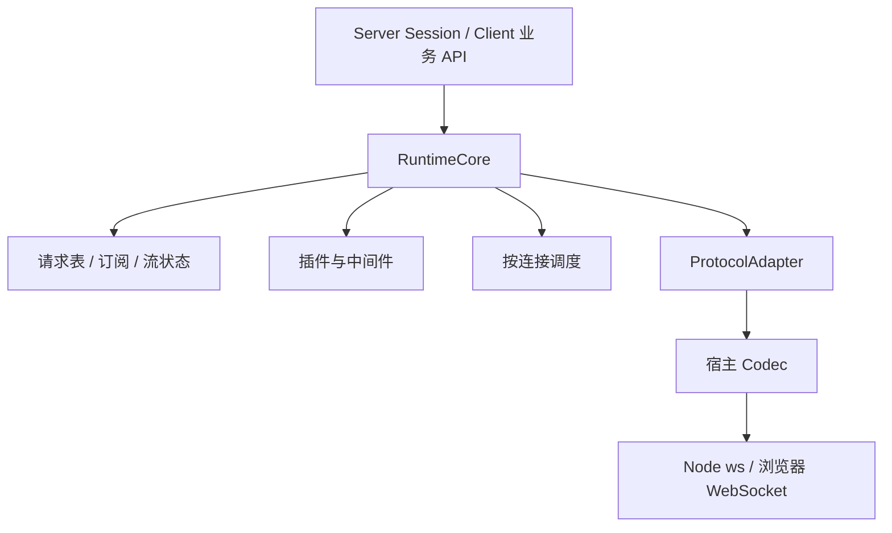

# ws-flow 架构编排与设计说明

更新：2026-09-28。本文说明当前模型的职责、数据路径和使用边界；旧设计文档中的未来 API、早期默认值和阶段状态以本文及代码为准。

## 1. 定位与模块边界

ws-flow 在 WebSocket 之上提供通知订阅、请求结果自动关联、流式任务管理。插件处理消息，调度器控制执行顺序，连接宿主处理环境与连接资源。

这保留了最初设计的价值，同时把容易耦合的职责分开：两端无需各实现一套任务系统，Protocol 无需管理任务，Scheduler 无需理解业务结果。

| 包 | 主要职责 |
| --- | --- |
| server | Node ws 接入、Session、房间、目标筛选、原有 route/handle 兼容 |
| client | 环境 socket、连接状态、重连、codec、公共 API |
| runtime-core | 收发编排、请求表、订阅、流生命周期、连接清理 |
| envelope | 配套消息形状与构建工具 |
| pipeline | 中间件组合与插件注册 |
| scheduler | 收发工作的排队与执行顺序 |
| consumer | 队列与异步消费基础 |

依赖方向是宿主进入 RuntimeCore，内核组合协议、管线、调度与任务模块。Server 与 Client 不依赖彼此。浏览器入口没有 Node ws；Node 入口通过 socket factory 使用 ws。

## 2. Protocol 为什么配置在 RuntimeCore

配置位置是依赖注入入口，职责仍在消息边界。内核只理解稳定的 RuntimeMessage；adapter.read 把对端结构解释成该结构，adapter.write 及任务编码器把内部消息还原成对端协议。codec 再转换 JSON/文本/二进制，transport 提交到 socket。

这个层级是合理的：内核依赖协议接口，不依赖某个服务器格式。Adapter 不创建 requestId，不持有连接，不存任务表，不决定重试和超时，也不直接发送消息。

Server 默认 wsFlowAdapter，普通用户无需理解 Protocol。Client 默认 genericAdapter，与配套 Server 通信时设置 protocol:'ws-flow'；连接第三方且需要事件/请求/流语义时才提供映射。

generic 把输入当业务数据。默认 JSON codec 不等于标准 Envelope，业务对象里的 requestId/kind 不会被误收进请求表。Adapter 同时声明能力：请求、请求流、主动流及其取消都必须得到对端协议支持。能力缺失时直接失败，不生成对端无法回应的“请求”。

## 3. 一条消息如何流动

接收路径：socket → codec.decode → adapter.read → 结构校验 → 入站调度 → receive 中间件 → 再校验/身份保护 → 按任务类别分流。

- 普通通知：给每个匹配订阅投递独立快照，再进入既有事件路由。订阅按原始解码消息筛选，同时提供标准化信息。
- 请求与响应：进入 RequestManager，选择处理器或结算对应任务，不重复作为普通通知分发。
- 主动流：按 Peer + streamId 查找 ReceiveStream，推进状态，将流交给 onStream 或旧路由。
- 取消控制：定位该 Peer 对应方向的任务并终止，不进入普通订阅。

发送路径：业务 API → 创建内部消息/任务身份 → 出站调度与中间件 → 身份校验 → adapter 编码 → codec.encode → transport。请求先登记再发送，避免快速响应找不到任务；发送失败回收记录。

默认收发各自按连接串行，不同连接可并行。请求处理器和流消费者的完整生命周期在帧调度外运行，可以等待未来帧，也能反向发起请求。短消息中间件仍参与串行推进，不宜在其中等待同连接未来响应。旧 route/handle 的普通通知处理也应避免这种等待，异步业务编排优先使用 on 或专用请求处理器。

## 4. 用户需要区分的四种意图

| 意图 | 发起方 | 接收方 | 结果 |
| --- | --- | --- | --- |
| 通知 | send / emit | subscribe / on | 无业务确认 |
| 单结果请求 | request | handleRequest | Promise |
| 流式请求 | requestStream | handleStream | 可取消的异步迭代任务 |
| 主动流 | stream | onStream | 流终态/取消 |

通知用于状态推送，请求用于调用后等待一个结果，请求流用于一次调用得到逐步结果，主动流用于未经请求就推送连续数据。

Server 的 Session 与 Client 在这四种能力上对等。Server 持有多个 Session，通过 all/to/except 及房间筛选构造 Sender，再由 requestAll 组合单连接请求。Server 没有隐式单一对端，不提供一个目标和返回值都不明确的全局 request。

requestAll 在调用时固定目标集合和顺序，各自并发请求，返回 `{session,status,value}` 或 `{session,status,reason}` 数组。单个失败不丢失其他结果，空目标返回空数组，新连接不加入本次任务。共享 signal 取消全部子请求，每个子请求独立结算。

广播 send/emit 仅代表发送，不收集业务结果。向多个目标发送主动流需要 generator factory，避免争抢同一个迭代器。多目标请求流尚无内置聚合 API，合并、排序和慢节点策略需要单独设计。

## 5. 任务隔离与生命周期

请求表按 Peer 对象身份隔离，入站/出站分别保存；两方向使用同一个 requestId 也不会互相取消。共享处理器按事件名唯一，Session 局部处理器可覆盖公共处理器。请求与处理器的单结果/流式模式不匹配时拒绝，不猜测转换。

结果、远端错误、超时、AbortSignal、断连、发送失败竞争同一终态，先到者胜出；结算后移除记录与监听，迟到响应忽略。默认总期限 30 秒，timeoutMs:null 可关闭。流式请求沿用总期限，收到 chunk 不会自动延长。taskTimeouts.incomingRequestMs 可配置独立入站执行期限，开始于处理器接纳阶段，覆盖结果发送/响应流；streamIdleMs 可配置流的有效进度期限，两项默认关闭。

StreamTask 有 waiting/open/ended/failed/cancelled 状态并提供异步迭代。start/chunk/end/error 推进流，响应流同时携带 requestId 和 streamId，主动流只使用流身份。

取消先结算本地，再尽力发送控制帧。请求使用 request_cancel；主动流接收方提前退出使用 stream_cancel；生产者本地取消会尽力发送终态错误。对端不支持取消或连接断开时，无法保证远端立即停止。入站处理器收到 signal，生成器被请求 return；用户内部未完成的 await 需要自行响应取消。

远端错误通过 code/message 传输并转换成可捕获错误，不传本地堆栈。message 仍可能包含业务细节，应用应控制对外错误内容。

## 6. 订阅、插件与资源归属

订阅不抢占消息：匹配者各收一份 structuredClone 快照，peer 是共享连接引用。谓词同步执行，谓词错误、消费异常或缓冲溢出只关闭对应订阅。无法克隆的数据会使对应订阅失败。

订阅和接收流默认缓冲 128 条；订阅和请求流可单独配置容量。流溢出失败并尝试取消。每 Peer 入站/出站请求默认各限制 1024 条；taskLimits 可覆盖，并增加四类任务及共享的全局/每 Peer 额度。请求流只计为请求，主动流单独计数。这些计数与宿主 transportLimits 分开：宿主负责原始消息、编码暂存字节及 socket 发送水位，消费者持有的业务对象不纳入宿主字节额度。

发送路径增加可选的 transport.prepare：在协议适配后进行编码、预留字节和等待水位，成功后才标记任务已进入传输，并调用准备结果的 send；finally 中 release。准备失败或等待时取消不会产生未开始任务的取消/终态帧。启用水位时，TransportSendQueue 持有同一连接的准入槽直到 send 完成，支持 Server 更换并发调度器而不重复放行相同缓冲余量。

插件模块化注册 receive/send、receiveStream/sendStream 和事件中间件，不拥有 ID 或任务表。请求、控制帧和主动流的 kind、requestId、resultMode、event、streamId、streamState 与连接身份均受保护，避免数据转换改变任务归属。普通通知也不能被中间件提升为任务。流钩子禁止直接改 peer/state，使用 end/fail 等控制方法改变生命周期；数据仍可转换。

Client 断连调用 closePeer，结算请求、关闭流、结束旧订阅；重连生成新 Peer，不重放命令。handler 注册复用，通知订阅按连接周期重建。Server detach/close 移除自己的监听和房间引用；takeover 的外部 WebSocketServer 仍由调用者管理。

## 7. 重连与大数据处理的实际边界

请求发出后断线，发起方无法确认对端是否已经执行，自动重发可能重复执行有副作用的业务。因此仅提供显式可选重连，旧任务失败。可靠重试需要业务幂等键和服务端去重。

当前没有消息落盘、跨进程任务迁移、已完成请求 ID 去重缓存、流恢复或端到端流量窗口。已可显式配置收发等待队列条数、单条/积压字节和发送高低水位，Client 入站覆盖解码与分发积压，取消可移除尚未开始的工作；还可限制登记中的活动任务数和执行/空闲期限。字节计量从 WebSocket 重组后的原始消息、以及出站编码之后开始，不覆盖解析器接收之前的分配、未编码对象或业务引用。任务期限结算逻辑生命周期，但无法停止忽略 signal 的业务函数；帧调度器也不替代业务执行池。大量连接/大块二进制仍需压力验证，不能据此宣称全部内存受控。详见三份资源限制文档。

## 8. 首版交付与后续边界

当前实现具备七包构建、严格声明检查、真实 socket 行为测试、仓库外 tarball 安装验证、真实 Edge 原生连接及超限关闭验证、可运行示例和 CI 配置。CI 文件已添加，本地结果不等于远端 CI 已运行。浏览器验证脚本输出本次示例的 minified 大小，包含示例使用的任务与资源限制功能，不含 gzip，也不代表所有使用方式的固定体积。

首版重点是完成原有通信模型和 GitHub/npm 交付：保留现有七包结构与 API，补有限的请求/流组合、重复连接清理回归，修复已发现的生命周期缺陷，完善包依赖、版本迁移、许可证与使用说明。Client 的重构按 2.x 迁移，已有 route/handle 继续作为兼容入口；不为发版另建协议层、重命名整套 API 或增加完整事件泛型映射。

持续大规模压力、完整多浏览器/Worker 矩阵、业务对象字节估算、端到端流窗口和多目标流聚合留待后续需要时推进。当前限额的合适配置取决于应用负载，单项测试不能给出通用容量，也不代表全部业务内存受控。

业务使用者优先理解四种通信意图。配套通信时 Client 设置 protocol:'ws-flow'，其他协议与调度细节可采用默认配置；只有适配第三方服务或调整消息处理时才需要深入 Adapter、Plugin 和 Scheduler。发布准备与验证记录见[发版评估](发版评估.md)。
